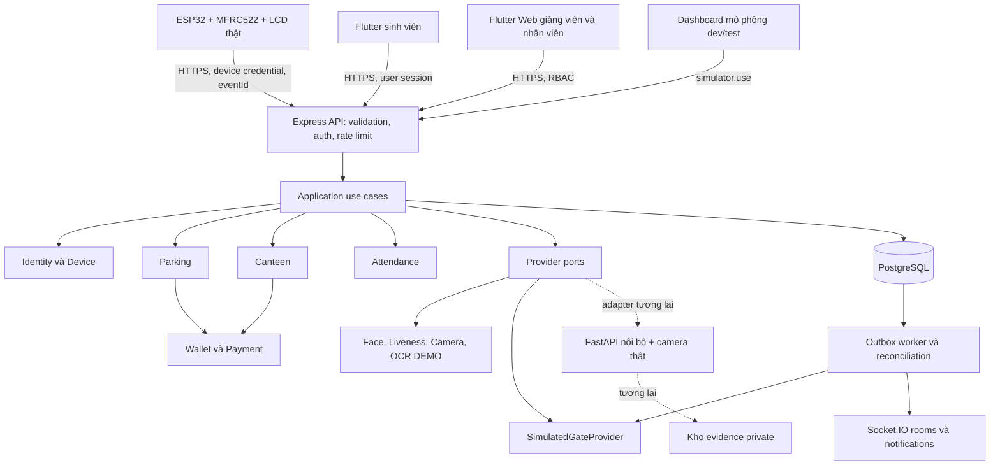
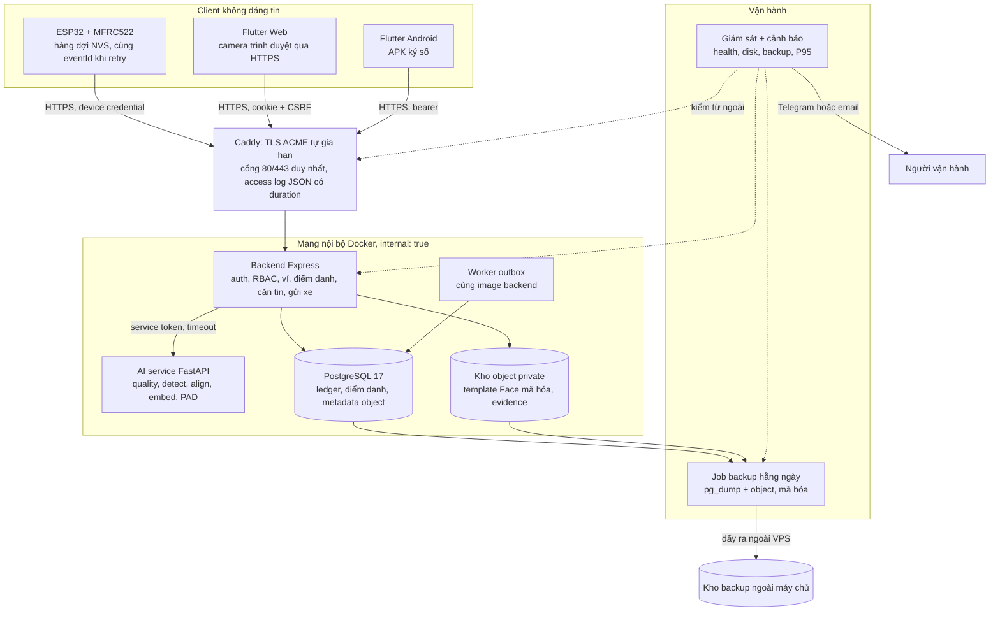

# Kiến trúc Smart Campus

> Thiết kế đã được người dùng duyệt ngày 05/11/2026. Đây là tài liệu thiết kế gốc; xem [trạng thái triển khai](implementation-status.md) và [runbook](SETUP_SMART_CAMPUS.md) cho code, lệnh chạy và bằng chứng hiện hành.

Ngày 05/11/2026, thiết kế đã được duyệt. Đây là kiến trúc mục tiêu, không mô tả mọi thành phần đã tồn tại. [Nguồn hiện có](legacy-analysis.md) là căn cứ đánh giá phần tái sử dụng.

> **Cập nhật 06/11/2026:** mục 1–8 mô tả MVP local đã duyệt. [Mục 9](#9-bổ-sung-06112026-kiến-trúc-production-và-các-điểm-còn-thiếu) bổ sung kiến trúc production theo kế hoạch 8 tuần v2: điểm danh RFID thật, Face 1:1 qua AI service, kho object private, backup ngoài máy chủ và giám sát. Mục 9 là đề xuất chờ nhóm/GV duyệt, chưa có code.

## 1. Quyết định công nghệ

| Quyết định đề xuất | Lý do và trade-off |
| --- | --- |
| Modular Monolith Express/TypeScript | Upstream và prototype cùng Express; không đổi sang NestJS chỉ để có DI/decorator. Một process API, một worker cùng codebase, một PostgreSQL bảo đảm transaction liên domain. Cần giữ ranh giới module bằng review/import rules |
| PostgreSQL 17, `pg`, SQL migrations | Đã có pg/SQL/constraints trong workspace. Giữ truy vấn parameterized và transaction rõ ràng, không thêm ORM ở MVP. Prisma/Drizzle là lựa chọn sau nếu nhóm cần typed query; không có ORM không có nghĩa bỏ migration/constraint. Chi phí là tự bảo trì mapping/SQL/types |
| Node 24/TypeScript theo metadata hiện có | Giữ toolchain trước khi có lý do nâng; GĐ2 phải xác nhận runtime/lock trên máy và CI. Không gọi version hiện tại là mới nhất |
| Flutter Android + Flutter Web | Tái sử dụng ngôn ngữ/widget, layout responsive riêng sinh viên/staff. Web không phụ thuộc Wi-Fi scan hoặc quyền camera để demo. Nếu sau này bảng dữ liệu lớn cần framework web riêng, đánh giá sau MVP |
| REST + Socket.IO | REST là nguồn snapshot/command; Socket.IO chỉ thông báo sau commit. Kế thừa ý tưởng upstream nhưng phải thêm auth/rooms/reconnect, dependency/version được kiểm trước GĐ6 |
| Demo providers trong backend | Không cần model/GPU/FastAPI để demo. FastAPI hiện có giữ như thử nghiệm riêng, chưa gọi trong luồng MVP |
| PostgreSQL outbox/worker | Chạy job cổng mô phỏng, notification, hết hạn reservation, reconciliation; chưa cần Redis/BullMQ. Một worker đủ, có claim/lease và retry bền |
| Chưa cần MinIO/S3 | DEMO dùng evidenceRef synthetic nội bộ. Khi ảnh thật xuất hiện, dùng private object storage và TTL URL, không lưu blob trong log hoặc public web |

## 2. Sơ đồ và trust boundary



ESP32 là reader, không là POS tính giá hay cơ sở ghi sổ. Dashboard là client không đáng tin: server tự chọn provider/source, kiểm fixture và quyền. FastAPI tương lai chỉ trả evidence nhận diện, không có credential DB ví. Ngay cả ADMIN cũng không thể biến DEMO thành REAL bằng payload.

## 3. Ranh giới module và execution flow

| Module | Sở hữu dữ liệu/use case | Gọi sang module khác |
| --- | --- | --- |
| identity | Users, students, lecturers, card lifecycle, biometric/consent | Không tự tạo chi trả |
| auth | Password/PIN hashing, user sessions, roles/permissions | Identity, audit |
| devices | Credential, config/role binding, challenge, event dedupe, identity assertion | Identity; dispatch context tới parking/canteen/enrollment |
| wallet | Accounts, holds, posting ledger, top-up, refund/reversal | Chỉ nhận lệnh server qua payment use cases |
| parking | Vehicle authorization, rates/pass, visits, OCR review, gate commands | Identity, wallet, provider ports |
| canteen | Catalog, inventory reservation, order lifecycle | Identity, wallet |
| attendance | Academic structure, roster snapshot, teacher sessions, attendance correction | Identity, provider ports; không phụ thuộc RFID role của parking |
| simulation | Kịch bản fixture và fault injection | Cùng application services; không có đường ghi nghiệp vụ tắt |
| platform | Audit/outbox/notifications, health, config, transaction boundary | Cung cấp hạ tầng chung tối thiểu |

Flow API: parse DTO → authenticate → authorization/resource scope → idempotency → application service → domain guards → transaction repositories → audit/outbox → commit → HTTP response. Worker đọc outbox sau commit. Không gọi network provider khi đang giữ khóa ví/kho/phiên.

Một use case phối hợp nhiều module bằng **cùng transaction connection**, không để mỗi repository tự commit. Domain nhận giá trị/time đã chuẩn hóa, không import Express/pg/FastAPI. Chưa cần generic repository, event bus nội bộ hoặc CQRS framework.

## 4. Folder structure mục tiêu và cách chuyển

```text
source/
  backend/
    server.ts                  # bootstrap hiện có, chuyển từng bước
    src/
      api/                     # middleware, error mapping, routes
      modules/
        auth/ identity/ devices/ wallet/ parking/ canteen/ attendance/
          domain/              # invariant và state transitions
          application/         # use cases, transaction boundary, provider ports
          infrastructure/      # SQL repositories, adapters
          api/                 # DTO/routes
      simulation/              # chỉ đăng ký route khi dev/test
      platform/                # config, DB transaction, audit, outbox, logger
      workers/                 # cùng module code với API
    test/                      # unit, integration, contract, E2E
  database/
    001.sql                    # không sửa lại migration prototype đã áp dụng
    migrations/                # các migration mới, ledger/migration history thống nhất
    seeds/                     # synthetic, chỉ dev/test
  firmware/rfid_spike/          # nâng cấp theo GĐ3; không chép secrets.h
  flutter/app/lib/
    features/                  # auth, student, parking, POS, attendance, admin, simulation
    core/                      # API client, auth storage, widget dùng lại
  ai-service/                  # tương lai; không bắt buộc khởi động demo
  deploy/                      # compose/proxy và profiles
  docs/                        # bộ tài liệu này
```

Cây trên là đích, không tạo scaffold rỗng trong thiết kế. Prototype `/v1/device-events` chỉ ATTENDANCE vẫn nguyên trạng; khi GĐ2–3 chuyển sang contract mới dùng `/api/v1/device-events`, đồng thời port firmware/tests. Không expose cả route cũ để né authorization; ngừng mount route prototype trong runtime mới. Không sửa `001.sql` đã áp dụng để giả vờ schema đã migration; xem [kế hoạch database](database-design.md).

## 5. Auth, thiết bị và bảo mật

- User: đề xuất opaque access session ngẫu nhiên 256 bit, lưu hash server, TTL 15 phút; refresh xoay vòng tối đa 7 ngày, revoke cả family khi phát hiện tái dùng. Không cần thêm JWT dependency để phục vụ một backend. Password và PIN dùng `node:crypto.scrypt` với salt riêng/parameters versioned, so sánh constant-time, benchmark trước chốt tham số.
- Web: access token trong RAM, refresh cookie HttpOnly/Secure/SameSite; refresh/logout kiểm Origin + CSRF. Android dùng OS secure storage qua package được kiểm/chốt GĐ7. Không localStorage token, không nhúng device token vào Flutter bundle.
- Device: credential riêng 256 bit, hash lưu DB; rotate/revoke bằng admin, response chỉ trả secret lúc cấp. TLS CA thật và hostname verification; không `setInsecure`. Credential bị lộ vẫn có thể giả thiết bị: cần quy trình cấp/lưu an toàn, không xem UID là chống clone.
- New scan cần challenge nonce ngắn hạn do backend cấp sau device auth, gắn device/configVersion/context. Server kiểm timestamp ±120 giây và nonce còn hạn 60 giây lần đầu; eventId durable chống retry. Replay cùng event chỉ trả trạng thái cũ, không tạo side effect mới. Challenge/dedupe không biến UID thành factor tài chính mạnh.
- Server lấy device từ credential; `deviceId` body chỉ là assertion phải khớp. Role/configVersion phải khớp binding server. STUDENT không có credential device hoặc simulator API.
- Payment approval: gắn student, amount, source ID/version, device/context và expiry; một lần. PIN không gửi qua ESP32/POS, không log; student xác nhận trên app của mình. 5 sai/15 phút và 100.000/lần, 500.000/ngày là config dev đề xuất, không chính sách tiền thật.
- Request DTO allowlist, CORS allowlist, SQL parameterized, rate limit shared bằng DB counters với một API instance MVP; trước scale nhiều instance phải kiểm cơ chế limit dùng chung. RBAC ở API và application use case, audit thao tác nhạy cảm.

## 6. Cấu hình môi trường mục tiêu

Đây là cấu hình thiết kế, **chưa được code hiện tại đọc**. Secret để trống trong `.env.example`, không điền giá trị từ upstream.

```dotenv
APP_ENV=development
RFID_MODE=REAL
FACE_PROVIDER=DEMO
LIVENESS_PROVIDER=DEMO
OCR_PROVIDER=DEMO
CAMERA_PROVIDER=DEMO
GATE_PROVIDER=SIMULATOR
PAYMENT_PROVIDER=MOCK
SIMULATOR_ENABLED=true
POINTS_PER_VND=1
DATABASE_URL=
CARD_HMAC_SECRET=
SESSION_PEPPER=
MOCK_CALLBACK_SECRET=
```

Các cấu hình khác: `HOST`, `PORT`, `PUBLIC_ORIGIN`, `ALLOWED_ORIGINS`, cookie policy, limits/timeouts, retention, device challenge TTL. PIN/password pepper và card HMAC có key version, backup/rotation riêng. Tỷ lệ point và policy nghiệp vụ được versioned trong DB; env chỉ bootstrap default, không âm thầm đổi lịch sử.

Bootstrap **không có flag bỏ qua**: nếu `APP_ENV=production` mà simulator enabled, hoặc bất kỳ Face/Liveness/OCR/Camera=DEMO, Gate=SIMULATOR, Payment=MOCK thì dừng trước listen. Provider không tồn tại/missing secret cũng dừng. MVP chỉ chạy dev/test; để chạy production sau này phải có adapter thật và đánh giá/duyệt riêng, không đổi tên provider để vượt guard. Test fail-closed cho tổ hợp biến cấu hình và route registration.

## 7. Tính nhất quán, worker và quan sát

- Idempotency key scope user+method+route, payload hash canonical, response lưu cùng transaction. Device scope `(device_id,event_id)`. Một key khác payload → 409. Retention response 90 ngày đề xuất; business unique key/callback ID/ledger source được giữ lâu hơn, không cho key hết hạn gây thu lại.
- Unique constraint bảo vệ kể cả request dùng key mới. Khóa row theo thứ tự thống nhất, retry deadlock/serialization tối đa 3 với jitter và cùng key. Lỗi unknown commit → query trạng thái, không tự tạo key mới.
- Outbox claim bằng lease và `FOR UPDATE SKIP LOCKED`, commit claim trước network call; commandId cố định qua retry. Delivery có thể lặp; consumer phải idempotent. Hết retry chuyển DEAD_LETTER + cảnh báo, không bỏ giao dịch ngầm.
- Log JSON: requestId/eventId, actor pseudonymous, deviceId, use case, result code, duration; không UID/PIN/token/raw face. Metric: ACK p95, duplicate/reject, lock timeout, hold quá hạn, gate UNKNOWN, inventory conflict, outbox lag, ledger discrepancy. Chưa thêm observability stack nặng; stdout và health đủ local, dashboard sau.
- Reconciliation so ledger sum với cached balance, holds với session/payment và stock reservation với order; lệch → alert/khóa posting liên quan, không sửa ledger tự động. Backup/restore và least-privilege DB role kiểm trước dữ liệu thật.

PostgreSQL cung cấp [row-level locks](https://www.postgresql.org/docs/17/explicit-locking.html) và [partial unique indexes](https://www.postgresql.org/docs/17/indexes-partial.html); ứng dụng vẫn phải chọn đúng transaction boundary, predicate và lock order. Cơ chế này không tự bảo đảm nghiệp vụ ví/cổng nếu service viết sai.

## 8. Điểm cần duyệt và rủi ro

Mặc định: Express + pg, Flutter Web/Android, demo in-process, PostgreSQL worker, không thêm ORM/Redis/model. Rủi ro chính là schema prototype đã tồn tại cần migration có backup, điện áp LCD chưa xác nhận, một reader phải demo tuần tự, license nguồn cần kiểm trước phân phối, và chưa có hardware evidence. Chỉ bắt đầu module lớn sau khi người dùng duyệt [roadmap](implementation-plan.md).

## 9. Bổ sung 06/11/2026: kiến trúc production và các điểm còn thiếu

Đối chiếu sơ đồ trong kế hoạch 8 tuần v2 với source hiện tại cho thấy năm khoảng trống: điểm danh RFID trên backend `campus`, Face 1:1 thật, nơi lưu template/ảnh Face, backup ngoài máy chủ và giám sát. Ba điểm khác của sơ đồ đã có trong source: gắn lần quẹt với đúng thao tác (`device_contexts` + `device_challenges` + `identity_assertions`), lệnh cổng do server phát (`gate_commands`) và 28 ca kiểm thử gốc ([THIET_KE_THAM_KHAO_02_11.md](THIET_KE_THAM_KHAO_02_11.md)).

### 9.1 Sơ đồ production mục tiêu



Khác biệt so với sơ đồ trong kế hoạch: thêm worker, kho object, khối giám sát; backup lấy cả DB lẫn object; AI chỉ backend gọi được và không có credential DB. Caddy ghi `duration` trong access log JSON (tương đương `$request_time` của Nginx) để tính P95 phía server.

### 9.2 Năm khoảng trống và cách xử lý đề xuất

| Khoảng trống | Hiện trạng trong source | Đề xuất | Tuần |
| --- | --- | --- | --- |
| Điểm danh RFID trên backend `campus` | `createSession` chỉ nhận thiết bị `ATTENDANCE_CAMERA` ([attendance.ts:15](../backend/src/attendance.ts)); `attendance_records.source` chỉ `DEMO`/`MANUAL`; RFID điểm danh chỉ có ở prototype `/v1/device-events` | Thêm role thiết bị `ATTENDANCE_READER`; context điểm danh nhận nhiều lượt quét trong phiên; scan ghi `attendance_records` ngay trong transaction của `/device-events`. Xem [migration 004](database-design.md#11-migration-004-đề-xuất-06112026) và [API](api-contracts.md#10-bổ-sung-06112026-điểm-danh-rfid-face-11-thật-object-và-vận-hành) | 2 |
| Face 1:1 thật | AI trả 503 ở `/internal/face/verify`; compose chỉ chạy AI trong profile `future-camera`; mọi Face là DEMO | Client gửi ảnh nén (cạnh dài ≤ 800 px) lên backend; backend lấy template của đúng sinh viên, gọi AI; đạt thì cấp `identity_assertions` hạn 60 giây, dùng một lần, gắn purpose và context. Lưu từng lần xác minh để tính FMR/FNMR/PAD/độ trễ | 3 |
| Nơi lưu template và ảnh Face | Không có object storage; `biometric_profiles` không có cột template | Kho object private (MinIO một node trong mạng nội bộ, hoặc thư mục volume riêng nếu nhóm muốn ít thành phần). Template mã hóa AES-GCM, khóa ngoài DB; bảng `stored_objects` giữ hash, retention, trạng thái xóa | 3–4 |
| Backup ngoài máy chủ | Có `pg_dump` + restore kiểm chứng thủ công ([verify-compose-backup.ps1](../tools/verify-compose-backup.ps1)); chưa có lịch, chưa mã hóa, chưa ra ngoài VPS | Job hằng ngày: `pg_dump -Fc` + snapshot kho object → restic (mã hóa sẵn) đẩy lên kho ngoài VPS; giữ 7 bản ngày + 4 bản tuần; job ghi kết quả để giám sát đọc | 4, 6 |
| Giám sát và cảnh báo | Chỉ có `/healthz`, `/readyz` và log stdout | Kiểm uptime từ bên ngoài VPS; script cron kiểm disk, container restart, tuổi bản backup mới nhất; báo qua Telegram hoặc email. P95 tính từ access log Caddy theo nhóm route | 6 |

Lựa chọn MinIO hay thư mục volume, dịch vụ uptime và kênh cảnh báo là quyết định của nhóm trong tuần 1; tài liệu không giả định đã mua hay cài.

### 9.3 Các điểm khác cần chốt với giảng viên

- **Xác nhận thanh toán.** Thiết kế trong kế hoạch cho phép xác nhận bằng RFID hoặc phiên Face. Source hiện yêu cầu sinh viên duyệt mọi khoản dương trên app bằng PIN (`payment_approvals`); quẹt thẻ chỉ nhận diện người. Đề xuất giữ PIN vì UID có thể sao chép; Face đạt PAD có thể thay PIN cho khoản nhỏ nếu GV đồng ý.
- **HTTPS.** [Caddyfile](../deploy/Caddyfile) dùng `tls internal` (CA local). Staging và production phải bỏ dòng này để Caddy tự lấy chứng chỉ ACME cho tên miền thật; ESP32 nạp root CA tương ứng.
- **Hàng đợi ESP32.** Firmware `smart_campus.ino` lưu một sự kiện pending trong NVS (`Preferences`), còn đoạn "Retry ... trong RAM" ở README thuộc prototype tuần 1. Hàng đợi chỉ giữ **một** sự kiện: khi còn pending, vòng lặp không đọc thẻ mới, nên mất mạng lâu thì cả hàng sinh viên phải chờ. Với điểm danh, cần quyết định giữ hàng đợi một phần tử (đơn giản, an toàn) hay mở rộng thành hàng đợi nhiều sự kiện trong NVS. Cần thử rút điện giữa lúc gửi trước khi ghi đạt tiêu chí 4 tuần 2.
- **Môi trường production.** Bootstrap từ chối `APP_ENV=production` khi còn provider DEMO/SIMULATOR/MOCK. Production theo kế hoạch vẫn dùng ví thử nghiệm và cổng mô phỏng, nên cần thêm chế độ `pilot` cho phép `PAYMENT_PROVIDER=MOCK`, `GATE_PROVIDER=SIMULATOR` nhưng tắt simulator route và bắt buộc Face REAL hoặc tắt Face.
