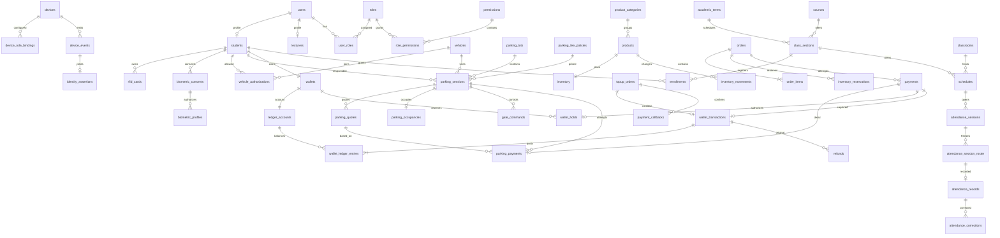
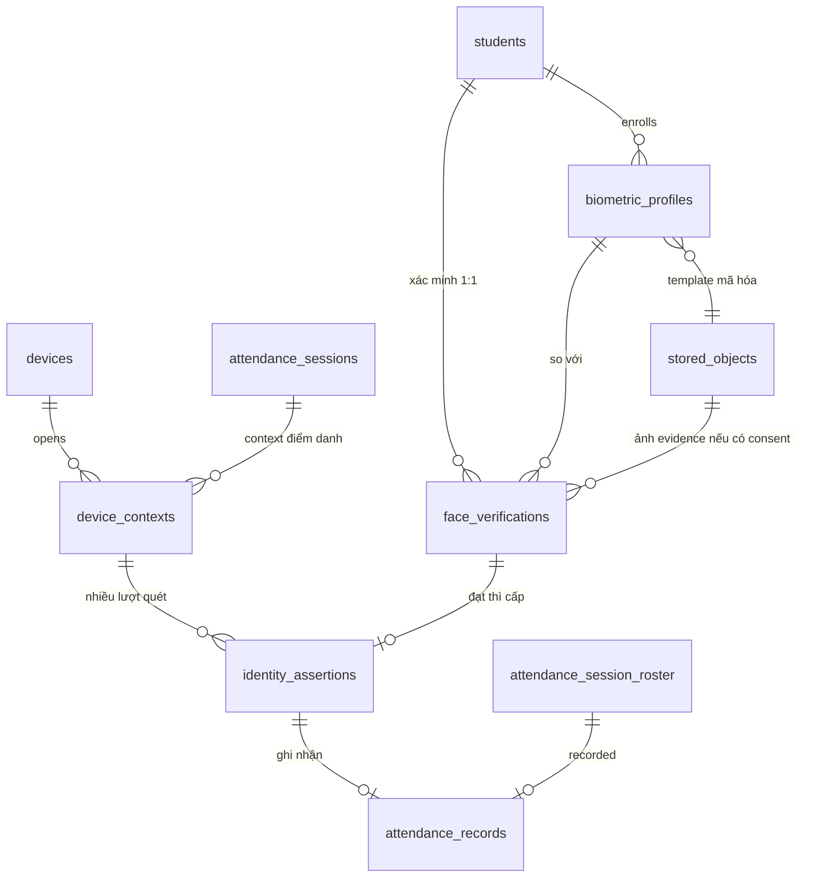

# Thiết kế dữ liệu, ERD và migration

> Thiết kế đã được người dùng duyệt ngày 05/11/2026. Đây là tài liệu thiết kế gốc; xem [trạng thái triển khai](implementation-status.md) và [runbook](SETUP_SMART_CAMPUS.md) cho code, lệnh chạy và bằng chứng hiện hành.

05/11/2026 — thiết kế PostgreSQL 17 chờ duyệt. **Chưa tạo/chạy migration mới**. `../database/001.sql` chỉ là schema prototype; tên bảng dưới đây là đích mới, không được coi là đã tồn tại.

> **Cập nhật 06/11/2026:** schema `campus` đã được tạo bằng [002-campus.sql](../database/migrations/002-campus.sql) và [003-operational-indexes.sql](../database/migrations/003-operational-indexes.sql). Khi dictionary dưới đây khác SQL (ví dụ `vehicle_authorizations` dùng PK `(vehicle_id, student_id)`, `idempotency_records` dùng PK `(scope, key)`), **SQL là căn cứ**. [Mục 11](#11-migration-004-đề-xuất-06112026) đề xuất migration 004 cho điểm danh RFID, Face 1:1 thật và kho object.

## 1. Quy ước

- PK dùng UUID, nghiệp vụ tiền/point dùng BIGINT integer, không float. Amount >0; ledger delta signed khác 0. API trả amount/point dạng chuỗi thập phân; tỷ lệ point/VND dùng số nguyên tử/mẫu dương và quy tắc rounding có version.
- Mốc thời gian `timestamptz` UTC, UI Asia/Ho_Chi_Minh. Mọi bảng có `created_at`; bảng mutable có `updated_at`, `version` cho optimistic concurrency. Ledger/audit/event/correction append-only dùng occurred/created_at thay updated_at.
- FK mặc định RESTRICT/NO ACTION cho tài chính/lịch sử. Không cascade xóa user vào ledger, attendance hoặc parking. Tài khoản khóa/anonymize theo chính sách, biometric/object xóa theo luồng riêng.
- Trạng thái dùng text + CHECK/migration, không lưu chuỗi tùy ý. FK có index phía tham chiếu nếu dùng join/filter/delete kiểm; không giả định PostgreSQL tự tạo mọi FK index.
- JSONB chỉ cho provider metadata/policy parameters/evidence, không giấu khóa nghiệp vụ hoặc số tiền trong JSON không có constraint. Không lưu password/PIN/UID raw trong metadata.

## 2. ERD tổng quan



ERD thể hiện quan hệ trọng tâm; dictionary dưới đây là danh mục đầy đủ. `wallet_transactions` chỉ chứa posting đã thành công; pending nằm ở payments/topup/holds.

## 3. Dictionary: danh tính, quyền và thiết bị

| Bảng | Cột nghiệp vụ và FK chính | Unique/check/trạng thái |
| --- | --- | --- |
| users | id, email_normalized, display_name, password_hash, status | email unique; ACTIVE/LOCKED/DISABLED |
| students | id, user_id→users, student_code, status, synthetic | user_id và student_code unique; ACTIVE/INACTIVE |
| lecturers | id, user_id→users, lecturer_code | cả hai unique |
| roles / permissions | id, code, description | code unique; 5 role theo SRS |
| user_roles / role_permissions | user_id+role_id / role_id+permission_id | composite PK/FK; scope tài nguyên kiểm thêm qua phân công |
| auth_sessions | id, user_id, access_hash, refresh_hash, family_id, expires_at, revoked_at | hash unique; refresh rotate và reuse detection |
| wallet_security_settings | student_id PK/FK, pin_hash, pin_version, failed_count, locked_until | không lưu PIN; lock rate counter atomically |
| rfid_cards | id, student_id, uid_hmac, hmac_key_version, status, expires_at, issued_by, revoked_at | ACTIVE/LOST/REVOKED/EXPIRED; partial unique active UID và active student |
| biometric_consents | id, student_id, purpose, policy_version, source, granted_at, revoked_at | source DEMO/REAL; lịch sử append-only grant/revoke event qua audit, không tự tái consent |
| biometric_profiles | id, student_id, consent_id, purpose, model_version, encrypted_template_ref, key_id, source, status, erased_at | ACTIVE/REVOKED/ERASED; DEMO không template thật; một active/student/purpose/model; purpose/student phải khớp consent |
| devices | id, name, kind, token_hash, status, config_version, last_seen_at, classroom_id/parking_lot_id tùy scope | RFID_READER/ATTENDANCE_CAMERA; ACTIVE/DISABLED/REVOKED; token hash unique |
| device_role_bindings | id, device_id, role, scope_id, config_version, effective_at, released_at, acknowledged_at | một binding chưa released/device; role khớp kind; scope_id không dùng làm FK polymorphic: lưu typed classroom_id/parking_lot_id/pos_code ở migration |
| device_contexts | id, device_id, binding_id, purpose, order_id hoặc parking_session_id hoặc parking_lot_id hoặc enrollment_student_id hoặc attendance_session_id, expires_at, state | typed FK + CHECK đúng một ngữ cảnh; một context mở/device; virtual attendance camera dùng session FK, source từ server |
| device_challenges | id, device_id, context_id, nonce_hash, config_version, expires_at, consumed_event_id | nonce hash unique, một lần; cấp qua device auth |
| device_events | id, device_id, event_id, context_id, payload_hash, accepted_at, occurred_at, source, result_code, http_status, response_json, purge_after | unique device+event_id; không giữ raw UID; source RFID=REAL |
| identity_assertions | id, device_event_id nullable, simulation_event_id nullable, student_id, device_id, purpose, context_id, source, expires_at, consumed_at, consumer_id | unique event nguồn; đúng một event source; không cho assertion dùng vào context khác |

`scope_id` trong mô tả là ký hiệu đọc, **không phải FK đa hình triển khai**. Quan hệ nguồn dữ liệu cần typed FK hoặc bảng join; kiểm FK không thể thay bằng JSON ID.

## 4. Dictionary: gửi xe

| Bảng | Cột chính | Ràng buộc |
| --- | --- | --- |
| vehicles | id, normalized_plate, raw_registered_plate, vehicle_type, status | normalized_plate unique trong registry MVP; ACTIVE/REVOKED; plate nhạy cảm không log công khai |
| vehicle_authorizations | id, vehicle_id, student_id, valid_from/to, status, granted_by | valid_to>from; unique active grant theo vehicle/student, kiểm cửa sổ bằng query dưới khóa |
| parking_lots | id, code, name, capacity, status | code unique; capacity>0; một bãi thử nghiệm |
| parking_fee_policies | id, lot_id, version_code, mode, parameters, effective_from/to, status | unique lot+version; bất biến sau activate; không active overlap cùng scope/priority qua activation service có khóa |
| parking_passes | id, student_id, vehicle_id, lot_id, valid_from/to, status, granted_by | tháng/miễn giảm entitlement; thời hạn hợp lệ; không miễn ngầm |
| parking_sessions | id, student_id, vehicle_id, lot_id, policy_id, status, exception_phase, settlement_cycle, entry_method/source, entry_plate/raw/confidence, exit_plate/raw/confidence, entered_at, exited_at, completed_at | PENDING_ENTRY/ACTIVE/EXIT_PENDING/COMPLETED/CANCELLED/EXCEPTION; settlement_cycle>=1; exit>=entry nếu có; vehicle/student đúng authorization tại thao tác |
| parking_quotes | id, session_id, settlement_cycle, version, amount_points, fee_snapshot, issued_at, expires_at, status | immutable amount/policy/pass/time snapshot; ACTIVE/CONSUMED/EXPIRED; một ACTIVE/session/cycle; không sửa amount sau approval |
| parking_occupancies | vehicle_id PK/FK, session_id unique/FK, lot_id | giữ khi PENDING_ENTRY/ACTIVE/EXIT_PENDING/EXCEPTION; chỉ release khi chứng minh chưa vào/đã ra và quyết toán |
| parking_events | id, session_id, type, source, evidence_ref, metadata, actor_id, device_event_id, occurred_at | append-only; entry/exit OCR, correction, override, passage, state change |
| parking_payments | id, session_id, payment_id unique, quote_id, settlement_cycle, amount_points, fee_snapshot | amount>0; mỗi payment thuộc đúng session/student/cycle; unique capture/session/cycle qua payments; nhiều attempt failed được phép |
| gate_commands | id, session_id, phase, sequence_no, provider, status, expires_at, dispatched_at, opened_at, passage_at, fenced_at, attempt_count | QUEUED/DISPATCHED/OPENED/PASSAGE_CONFIRMED/FAILED/UNKNOWN/REVOKED; unique session+phase+sequence; một command chưa giải quyết/phase |
| gate_provider_events | id, command_id, provider, provider_event_id, type, received_at, payload_hash | unique provider+event ID; passage event bền trước capture; simulator cũng dùng bảng này |

Occupancy table giữ unique vehicle cả khi EXCEPTION không rõ vị trí. Partial unique sau đây bổ sung constraint theo trạng thái; không dùng chỉ ACTIVE vì sẽ lọt hai PENDING_ENTRY/EXIT_PENDING:

```sql
-- SQL minh họa migration đích, không chạy lên 001.sql hiện có.
CREATE UNIQUE INDEX parking_one_unsettled_vehicle
ON parking_sessions(vehicle_id)
WHERE status IN ('PENDING_ENTRY','ACTIVE','EXIT_PENDING','EXCEPTION');

CREATE UNIQUE INDEX attendance_one_record
ON attendance_records(session_id, student_id);

CREATE UNIQUE INDEX rfid_one_active_student
ON rfid_cards(student_id) WHERE status = 'ACTIVE';
CREATE UNIQUE INDEX rfid_one_active_uid
ON rfid_cards(uid_hmac) WHERE status = 'ACTIVE';
```

HMAC rotation không được để cùng UID tồn tại dưới hai version vượt unique: migration rotation dưới maintenance lock, đối chiếu current/previous digest khi lookup/issue, backfill digest có nguồn UID hợp lệ hoặc yêu cầu quét lại; không thể tự tính HMAC mới từ digest cũ. Không đổi secret rồi âm thầm làm mọi thẻ mất hiệu lực.

## 5. Dictionary: ví và thanh toán

| Bảng | Cột chính | Ràng buộc |
| --- | --- | --- |
| ledger_accounts | id, kind, balance_points | STUDENT/CANTEEN/PARKING/MOCK_SOURCE/ADJUSTMENT; student balance>=0; chỉ source đối ứng được phép âm |
| wallets | id, student_id unique, account_id unique, status | một ví/SV; ACTIVE/FROZEN; account FK đúng kind qua posting guard/migration trigger |
| wallet_transactions | id, type, payment_id nullable unique, topup_order_id nullable unique, refund_id nullable unique, adjustment_id nullable unique, original_transaction_id nullable, posted_at | TOP_UP/CANTEEN_PAYMENT/PARKING_PAYMENT/REFUND/REVERSAL/ADMIN_ADJUSTMENT; CHECK đúng source theo type, chỉ POSTED |
| wallet_ledger_entries | id, transaction_id, account_id, delta_points, created_at | unique transaction+account; delta!=0; tối thiểu hai entry, tổng delta=0 lúc commit; append-only |
| wallet_holds | id, wallet_id, payment_id unique, amount_points, status, expires_at, captured_transaction_id | ACTIVE/CAPTURED/RELEASED; >0; captured FK unique; dispatched parking hold không auto-expire |
| payments | id, student_id, wallet_id, order_id nullable, parking_session_id nullable, settlement_cycle, attempt_no, amount_points, status, captured_transaction_id, refund_status | đúng một order/session; amount>0; CREATED/AWAITING_CONFIRMATION/AUTHORIZED/CAPTURED/VOIDED/CANCELLED/EXPIRED; unique source+cycle+attempt, một CAPTURED/source/cycle; order cycle luôn 1 |
| payment_approvals | id, payment_id, student_id, source_version, device_context_id, amount_points, method, expires_at, consumed_at, pin_version | PIN/APP; immutable binding; invalidate khi đổi amount/version, mất thẻ/khóa user |
| topup_orders | id, wallet_id, requested_vnd, amount_points, conversion_version, provider, status, provider_reference, expires_at | PENDING/SUCCEEDED/FAILED/CANCELLED/EXPIRED/REVIEW_REQUIRED; unique provider reference |
| payment_callbacks | id, provider, provider_event_id, topup_order_id, payload_hash, verification_status, processing_result | unique provider+event ID, append-only; không lưu secret signature/body tùy tiện |
| refunds | id, original_transaction_id, amount_points, reason, actor_id, status, refund_transaction_id | REQUESTED/POSTED/REJECTED; khóa original để giới hạn tổng hoàn; partial theo item ở refund_items |
| refund_items | refund_id, order_item_id, quantity, amount_points, restock_quantity | composite PK, qty>0, 0<=restock<=qty; tổng hoàn item <= đã bán |
| wallet_adjustments | id, wallet_id, delta_points, reason, approved_by, transaction_id | quyền wallet.adjust; không delta 0; negative vẫn không âm balance |
| wallet_daily_usage | wallet_id, business_date, charged_points | PK wallet+date; cập nhật dưới wallet lock; không giảm tự động khi refund trừ khi policy cho phép |
| point_conversion_policies | id, version_code, points_numerator, vnd_denominator, rounding, effective_at | số dương; version unique; snapshot trên top-up, không revalue ledger cũ |

Invariant posted balance = SUM(entries.delta); available = posted − SUM(active holds). Cache balance chỉ cập nhật trong posting transaction, quyền DB app không được UPDATE cache tùy ý ngoài posting function/service đã kiểm. Đề xuất hàm SQL posting nhận source ID và entry sets, kiểm source amount/accounts/ownership, update balance dưới khóa; app không có quyền INSERT trực tiếp ledger ngoài hàm. Migration owner khác app role; test permission thực tế bằng app role, không test chỉ bằng superuser.

Trigger deferred kiểm tổng cân bằng; trigger immutable chặn UPDATE/DELETE header/entry, seal ngăn thêm entry vào transaction cũ sau commit. Chỉ cân bằng delta=0 **chưa đủ**: cần kiểm đúng account kind, chủ ví, source amount và refund bound. Reconciliation chạy lại tổng ledger/holds với cache và cảnh báo; không tự sửa số liệu.

Idempotency và unique capture là hai lớp riêng: partial unique payments(order_id) và payments(parking_session_id,settlement_cycle) WHERE status='CAPTURED'; wallet_transactions.payment_id/topup_order_id/refund_id unique vĩnh viễn. Attempt đã void có thể thử mới trong cùng cycle nhưng không có hai attempt sống cùng source/cycle (partial unique trạng thái CREATED/AWAITING_CONFIRMATION/AUTHORIZED).

Parking mặc định chỉ một settlement_cycle. Chỉ tăng cycle trong resolution có quyền khi capture cũ đã **reversal toàn bộ**, chứng minh xe chưa ra, lệnh cũ đã fence và giữ occupancy; các quote/approval cycle cũ vô hiệu. Nhờ vậy retry hợp lệ sau lỗi đã hoàn không bị unique constraint khóa vĩnh viễn, trong khi không có hai khoản thu ròng cho cùng lượt. Partial refund không cho phép tăng cycle. Composite FK/guard ràng buộc quote/payment/cycle/session; event cổng cycle cũ không được charge cycle mới. FK vòng payment↔transaction/refund được tạo deferred hoặc nullable link cập nhật trong cùng transaction, không bỏ FK vì vòng tham chiếu.

## 6. Dictionary: cantin

| Bảng | Cột chính | Ràng buộc |
| --- | --- | --- |
| product_categories | id, name, status | ACTIVE/INACTIVE |
| products | id, category_id, sku, name, image_ref, price_points, price_version, status | sku unique; price>0 trong MVP; ACTIVE/UNAVAILABLE/ARCHIVED; sản phẩm miễn phí là thay đổi policy cần thiết kế/test riêng |
| inventory | product_id PK/FK, on_hand, reserved, version | 0<=reserved<=on_hand |
| inventory_movements | id, product_id, kind, quantity_delta, reservation_delta, order_item_id, refund_item_id, adjustment_reason, actor_id | append-only; RECEIVE/RESERVE/RELEASE/SALE/RETURN/ADJUST; source+kind unique để retry không trừ hai lần |
| inventory_reservations | id, order_id, product_id, quantity, status, expires_at | unique order+product; ACTIVE/CONSUMED/RELEASED; qty>0 |
| orders | id, created_by, student_id nullable trước scan, status, order_version, total_points, expires_at, completed_at | DRAFT/AWAITING_PAYMENT/COMPLETED/CANCELLED/EXPIRED; refund NONE/PARTIAL/FULL riêng |
| order_items | id, order_id, product_id, quantity, unit_price_points, price_version, line_total_points | unique order+product, qty>0; line=qty*price; order total tính server từ items |

Order/payments/wallet phải cùng student; dùng composite unique `(id,student_id)` và composite FK ở payment khi schema hỗ trợ nullable student trước identity, đồng thời khóa bind student một lần trước approval. Không cho thay chủ đơn đã có approval/capture. Giá item snapshot bất biến sau AWAITING_PAYMENT; sửa đơn tạo version và cập nhật reservation có transaction.

## 7. Dictionary: học vụ và điểm danh

| Bảng | Cột chính | Ràng buộc |
| --- | --- | --- |
| academic_terms | id, code, starts_at, ends_at, status | code unique, ends>starts |
| courses | id, code, name | code unique |
| class_sections | id, term_id, course_id, code, status | unique term+code |
| teaching_assignments | section_id, lecturer_id, valid_from/to | PK/FK theo phân công, kiểm hiệu lực |
| enrollments | section_id, student_id, status, enrolled_at | PK section+student; ACTIVE/WITHDRAWN |
| classrooms | id, code, name | code unique |
| schedules | id, section_id, classroom_id, starts_at, ends_at | ends>starts; MVP schedule từng buổi, không dựng recurrence engine |
| attendance_sessions | id, schedule_id, section_id, classroom_id, opened_by, status, opens_at, late_after, closes_at, opened_at, closed_at | SCHEDULED/OPEN/CLOSED/CANCELLED; một OPEN/section/schedule; guard thời gian |
| attendance_session_devices | session_id, device_id, released_at | PK session+device; một unreleased binding/device; camera đúng classroom |
| attendance_session_roster | session_id, student_id, enrollment_snapshot | PK session+student; snapshot để thay enrollment không sửa lịch sử |
| attendance_records | id, session_id, student_id, status, method, source, received_at, identity_assertion_id, corrected_at | unique session+student; composite FK roster; PRESENT/LATE/ABSENT/EXCUSED; ABSENT không cần assertion |
| attendance_corrections | id, record_id, request_id, old_status, new_status, reason, actor_id, occurred_at | append-only; reason bắt buộc; audit cùng transaction |
| attendance_adjustment_requests | id, session_id, student_id, requested_status, reason, status, decided_by | PENDING/APPROVED/REJECTED, student chỉ tạo cho mình |

Close giữ session lock cùng ingestion, tạo ABSENT bằng INSERT ON CONFLICT DO NOTHING và status CLOSED atomically. Device/class/session FK và check role không tự bảo đảm permission GV; phải kiểm trong use case trước write.

## 8. Dictionary: hạ tầng chung

| Bảng | Nội dung | Ràng buộc/index |
| --- | --- | --- |
| notifications | id, recipient_user_id, type, resource_id, safe_payload, read_at | index recipient+created_at; không gửi raw UID/PIN |
| audit_logs | id, actor_user/device/service, action, resource_type/id, before/after đã lọc, reason, request_id, event_id | append-only; index actor/date, resource/date; exactly một actor type hoặc SYSTEM |
| idempotency_records | id, actor_type/id, method, route_scope, key, payload_hash, state, response_status/body, expires_at | unique actor+method+scope+key; IN_PROGRESS/COMPLETED; lưu response cùng commit, không giữ PIN trong hash input/log |
| outbox_events | id, aggregate_type/id, event_type, payload, status, available_at, lease_until, attempts, published_at | PENDING/PROCESSING/PUBLISHED/DEAD_LETTER; index status+available_at; payload tối thiểu |
| simulation_events | id, actor_id, device_id, session/context_id, scenario, source, result_metadata | source DEMO/SIMULATOR; fixture IDs only; audit |
| schema_migrations | version, checksum, applied_at | version PK; không sửa migration đã chạy |
| rate_limit_counters | scope, bucket_start, count, expires_at | PK scope+bucket; atomic increment; dọn TTL |

Index vận hành thêm: parking(student,status), parking(lot,entered_at), ledger(account,created_at,id), orders(status,expires_at), reservations(status,expires_at), holds(status,payment_id), attendance(session,status), device_events(device_id,accepted_at), gate_commands(status,expires_at), topup(wallet,created_at). List API dùng cursor `(created_at,id)`, limit<=100.

## 9. Khóa, concurrency và transaction

Thứ tự chuẩn cho checkout/refund: **source aggregate (order hoặc parking session) → payment/original transaction → inventory theo product UUID tăng → wallets/ledger accounts theo UUID tăng → counter/entries/outbox**. Top-up không có order nên khóa top-up trước rồi accounts; không gọi ngược từ account sang order. Entry khóa vehicle trước lot để tính capacity; role config khóa device trước context, không gọi domain khi đang giữ device lock nếu domain có đường khóa ngược. GĐ2 phải kiểm lock graph bằng integration test, không chỉ tuân theo tên thứ tự trong tài liệu.

- Atomic conditional update balance với điều kiện available đủ, dưới row lock; CHECK balance>=0 là lớp bảo vệ cuối. Daily usage kiểm trong cùng wallet lock.
- Refund khóa source/original trước tổng hợp refunds; reversal cũng tính vào tổng hoàn, không có đường refund thứ hai vượt cap.
- Attendance mở/đóng/ingest dùng session lock; mở phiên khóa class+device binding theo thứ tự xác định. Đối với event device: claim event ngắn hạn trước, xử lý domain và response trong cùng transaction có uniqueness, tránh giữ device lock dài khi cần khóa domain.
- Unique errors map 409/domain duplicate; deadlock/serialization retry hữu hạn cùng key. Network timeout sau commit: client GET status/ retry cùng key, không tự dùng key mới.

## 10. Kế hoạch migration và bảo toàn dữ liệu

| Bước dự kiến | Thay đổi | Điều kiện/check |
| --- | --- | --- |
| M0 inventory | Đọc schema version thực tế, row counts, dữ liệu dev có cần giữ, backup và restore thử | Không suy từ việc có 001.sql rằng DB đã apply; không xóa volume |
| M1 core | Roles/permissions/auth sessions/device config; đổi `student_cards`→`rfid_cards`, map TEACHER→LECTURER, CANTEEN→CANTEEN_STAFF, PARKING→PARKING_STAFF | Giữ UUID; rename/copy rõ ràng, tạm adapter cho prototype; duplicate active card phải xử lý trước unique |
| M2 wallet | `ledger_transactions/entries`→`wallet_transactions/wallet_ledger_entries`; accounts, holds, topup, callbacks, approval, grants | Bảo toàn entry delta và IDs; mapping TOPUP/SALE/REVERSAL dựa source thực, không đoán SALE là cantin nếu thiếu nguồn; dữ liệu mơ hồ vào review |
| M3 parking | Vehicles plate registry, authorizations, policy, state, occupancy, gate events | `vehicle_code` cũ không chắc là biển: yêu cầu map; closed_at null không tự kết luận xe ở trong bãi nếu thiếu evidence |
| M4 canteen | Categories/products/inventory/orders/reservation/refunds | Map menu_items/canteen_orders có snapshot; không tạo stock thực từ giá/đơn lịch sử |
| M5 academic | classes→class_sections, terms/courses/lecturers/schedule, class_sessions→attendance_sessions, roster/corrections | Bổ sung mapping term/course/schedule thiếu; giữ attendance IDs/source RFID; face_profiles chuyển theo consent đã xác minh |
| M6 hardening | FK NOT NULL/unique sau backfill, grants/triggers, indexes, purge/anonymize jobs | Validate counts/balance/constraints và contract tests, retire route prototype |

Migration code chỉ viết ở giai đoạn tương ứng sau duyệt. Không DROP bảng/column cũ trước đối chiếu/backfill và thời gian rollback; rollback tài chính ưu tiên forward fix, không xóa posting mới. Dev database mới có thể tạo schema đích sạch từ migration chain, nhưng mọi reset phải chỉ rõ DB test và được phân biệt với DB đang có dữ liệu. Seed synthetic có ID ổn định, không user thật, không credential hardcode, không reapply để cộng point lần hai.

Nguồn tham khảo: PostgreSQL [row locks](https://www.postgresql.org/docs/17/explicit-locking.html), [partial indexes](https://www.postgresql.org/docs/17/indexes-partial.html). SQL minh họa trong tài liệu chưa là bằng chứng migration thực thi được.

## 11. Migration 004 đề xuất (06/11/2026)

Migration 004 lấp ba khoảng trống của schema `campus` so với kế hoạch 8 tuần v2. Đây là SQL đề xuất để review, **chưa có file migration, chưa chạy**. Tên constraint CHECK dưới đây là tên PostgreSQL tự sinh cho CHECK khai báo inline; phải kiểm bằng `\d campus.<bảng>` trên DB thật trước khi viết file.

### 11.1 ERD phần bổ sung



### 11.2 Điểm danh RFID trên `campus`

Hiện `createSession` chỉ nhận `ATTENDANCE_CAMERA`, mỗi `device_contexts` bị tiêu thụ sau một lượt quét và `attendance_records.source` không có `REAL`. Một phiên điểm danh cần một context sống suốt phiên và nhận nhiều thẻ.

```sql
SET LOCAL search_path = campus, public;

-- Role thiết bị mới cho reader trong phòng học.
ALTER TABLE devices DROP CONSTRAINT devices_role_check;
ALTER TABLE devices ADD CONSTRAINT devices_role_check CHECK (role IN
  ('PARKING_ENTRY','PARKING_EXIT','CANTEEN_POS','RFID_ENROLLMENT','ATTENDANCE_CAMERA','ATTENDANCE_READER'));

-- Context điểm danh nhận nhiều lượt quét đến khi phiên đóng.
ALTER TABLE device_contexts ADD COLUMN multi_use boolean NOT NULL DEFAULT false;
ALTER TABLE device_contexts ADD CONSTRAINT multi_use_only_attendance
  CHECK (NOT multi_use OR purpose = 'ATTENDANCE');

-- Bản ghi điểm danh biết nguồn thật, phương thức và lần xác thực đã dùng.
ALTER TABLE attendance_records DROP CONSTRAINT attendance_records_source_check;
ALTER TABLE attendance_records ADD CONSTRAINT attendance_records_source_check
  CHECK (source IN ('REAL','DEMO','MANUAL'));
ALTER TABLE attendance_records
  ADD COLUMN method text CHECK (method IN ('RFID','FACE','MANUAL')),
  ADD COLUMN identity_assertion_id uuid UNIQUE REFERENCES identity_assertions;
ALTER TABLE attendance_records ADD CONSTRAINT real_needs_assertion
  CHECK (source <> 'REAL' OR (identity_assertion_id IS NOT NULL AND method IN ('RFID','FACE')));
```

Chống trùng vẫn dựa vào ràng buộc có sẵn: `device_events UNIQUE(device_id, event_id)` cho retry của ESP32 và `attendance_records UNIQUE(session_id, student_id)` cho quét lặp. Mở phiên tạo context `multi_use` hết hạn lúc `schedules.ends_at`; đóng phiên chuyển context sang `CONSUMED` trong cùng transaction tạo ABSENT. Code cần sửa: `attendance.createSession/openSession` (nhận `ATTENDANCE_READER`), `devices.roleForPurpose` (ATTENDANCE nhận cả `ATTENDANCE_READER`), `devices.createContext` (hạn theo phiên thay vì 5 phút), `devices.scan` (context `multi_use` thì ghi điểm danh ngay, không đổi context sang `CONSUMED`) và `devices.changeRole` (cho phép role mới).

### 11.3 Kho object và template Face

```sql
CREATE TABLE stored_objects(
  id uuid PRIMARY KEY,
  kind text NOT NULL CHECK (kind IN ('FACE_TEMPLATE','FACE_EVIDENCE','PRODUCT_IMAGE')),
  object_key text UNIQUE NOT NULL,          -- đường dẫn trong kho private, không phải URL công khai
  sha256 text NOT NULL,
  size_bytes bigint NOT NULL CHECK (size_bytes > 0),
  content_type text NOT NULL,
  encryption_key_id text,                    -- bắt buộc với dữ liệu Face
  owner_student_id uuid REFERENCES students,
  retention_until timestamptz,
  erased_at timestamptz,
  created_at timestamptz NOT NULL DEFAULT now(),
  CHECK (kind = 'PRODUCT_IMAGE' OR (encryption_key_id IS NOT NULL AND owner_student_id IS NOT NULL))
);

ALTER TABLE biometric_profiles
  ADD COLUMN template_object_id uuid UNIQUE REFERENCES stored_objects,
  ADD COLUMN template_dim integer CHECK (template_dim > 0);
ALTER TABLE biometric_profiles ADD CONSTRAINT real_profile_has_template
  CHECK (source <> 'REAL' OR status <> 'ACTIVE' OR template_object_id IS NOT NULL);
```

Template là embedding đã mã hóa AES-GCM, khóa giữ ngoài DB (biến môi trường hoặc file secret, có `key_id` để xoay khóa). Ảnh gốc chỉ lưu khi consent cho phép, có `retention_until`; xóa profile thì xóa object và đặt `erased_at`, không chỉ ẩn trên UI. Backup gồm cả DB lẫn kho object; restore phải khớp `sha256` của từng object.

### 11.4 Lịch sử xác minh Face 1:1

```sql
CREATE TABLE face_verifications(
  id uuid PRIMARY KEY,
  student_id uuid NOT NULL REFERENCES students,
  profile_id uuid NOT NULL REFERENCES biometric_profiles,
  context_id uuid NOT NULL REFERENCES device_contexts,
  purpose text NOT NULL CHECK (purpose IN ('ATTENDANCE','CANTEEN','PARKING')),
  model_version text NOT NULL,
  quality_status text NOT NULL CHECK (quality_status IN ('OK','BLURRY','TOO_DARK','NO_FACE','MULTIPLE_FACES')),
  similarity numeric CHECK (similarity BETWEEN -1 AND 1),
  threshold numeric NOT NULL,
  pad_status text NOT NULL CHECK (pad_status IN ('PASS','FAIL','UNKNOWN')),
  pad_score numeric,
  decision text NOT NULL CHECK (decision IN ('MATCH','NO_MATCH','REJECTED','ERROR')),
  ai_latency_ms integer CHECK (ai_latency_ms >= 0),
  evidence_object_id uuid REFERENCES stored_objects,
  identity_assertion_id uuid UNIQUE REFERENCES identity_assertions,
  created_at timestamptz NOT NULL DEFAULT now(),
  CHECK (decision <> 'MATCH' OR (pad_status = 'PASS' AND quality_status = 'OK' AND identity_assertion_id IS NOT NULL))
);
CREATE INDEX face_verification_history ON face_verifications(student_id, created_at DESC);
CREATE TRIGGER immutable_face_verification BEFORE UPDATE OR DELETE ON face_verifications
  FOR EACH ROW EXECUTE FUNCTION immutable_row();
```

`face_verifications` là nguồn số liệu cho tiêu chí 3 tuần 3 (FMR, FNMR, PAD, độ trễ) và cho audit. Phiên xác minh dùng một lần, hết hạn nhanh và gắn mục đích chính là `identity_assertions` hiện có (`expires_at` 60 giây, `consumed_at`, `context_id`); không thêm bảng `verification_sessions` riêng. `consumeIdentity` đã từ chối assertion hết hạn, đã dùng hoặc sai ngữ cảnh.

### 11.5 Không đưa vào DB

Kết quả backup và số đo giám sát **không** lưu trong DB nghiệp vụ: bản restore sẽ không có lần backup mới nhất và DB chết thì không báo được lỗi. Job backup ghi log/heartbeat ra ngoài (file trạng thái + kênh cảnh báo), xem [architecture.md mục 9](architecture.md#9-bổ-sung-06112026-kiến-trúc-production-và-các-điểm-còn-thiếu).

Kiểm thử bắt buộc khi viết migration 004: áp lên bản restore của DB staging có dữ liệu; quét cùng thẻ hai lần chỉ một bản ghi; retry cùng `eventId` trả ACK cũ; ghi `source='REAL'` thiếu assertion bị CHECK chặn; `MATCH` thiếu PAD bị chặn; runtime role không UPDATE/DELETE được `face_verifications`.
